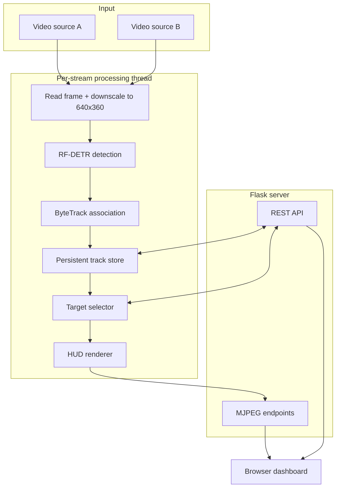
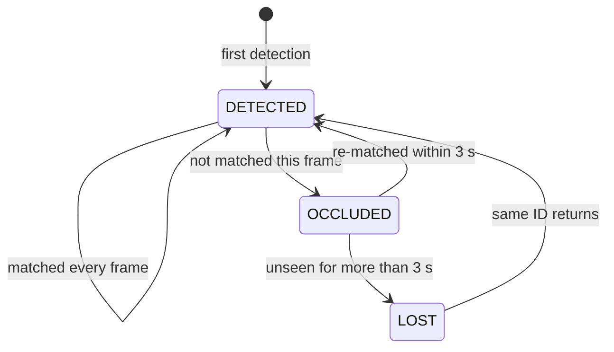

<div align="center">

# VisionEdge-UAV

### Real-time target detection, tracking and lock-on for UAV-style video, with an operator HUD streamed to the browser


[Overview](#overview) · [Architecture](#system-architecture) · [Track lifecycle](#track-lifecycle) · [Target selection](#target-selection) · [HUD](#operator-hud) · [Configuration](#configuration-reference) · [API](#api-reference) · [Quick start](#quick-start) · [Roadmap](#roadmap)

</div>

---

## Overview

VisionEdge-UAV is the **perception and operator-view layer** of an unmanned-aerial-vehicle autonomy stack. It ingests video, detects objects with a transformer-based detector (**RF-DETR**), keeps persistent identities with **ByteTrack**, chooses a **priority target** according to mission rules, and renders an operator-grade **heads-up display** that any browser can watch live over MJPEG.

The question it answers is the one an operator actually has when watching drone footage: *of everything the camera sees, what should I be locked onto, is it still there, and which way do I need to move to keep it centred?*

It is the perception foundation for the search-and-rescue drone project **SAR_DRONE (Khoj-o-Drone)**, and it is designed so the same detections can later drive flight control.

### Highlights

| | |
|---|---|
| **Priority-aware lock-on** | Targets are ranked by class priority (people first, then vehicles) and then by size; the operator can restrict the active category live |
| **Occlusion recovery** | Lost tracks are kept for 3 s with a velocity-extrapolated predicted position, drawn as a dashed "re-acquire" box |
| **Follow guidance** | Correction arrows show how far the target is from the desired position in frame, with a dead-band to suppress jitter |
| **Operator HUD** | Crosshair, corner-bracket target boxes, trajectory trails, velocity vectors, status banner, live FPS, every layer switchable in config |
| **Dual streams** | Two independent video streams (A/B) with a switchable active stream |
| **Fault tolerant** | Missing source, a failed inference, or a slow frame never kills the feed |
| **Dataset modes** | COCO, VisDrone and UAVDT class mappings selectable in one setting |

---

## System architecture



Each video stream is handled by its own **daemon thread** that owns a detector instance, a persistent track store and a HUD renderer. The Flask server never runs inference; it only serves the most recent annotated frame from a lock-protected buffer, so a slow model cannot block HTTP requests.

### Components

| Component | Responsibility |
|---|---|
| `AdaptiveDetector` | Wraps the detection model. Uses **RF-DETR** (`RFDETRBase` or `RFDETRLarge`); if the `rfdetr` package is unavailable it falls back to **Ultralytics RT-DETR-L** so the pipeline still runs |
| `ObjectDetectorTracker` | Owns one stream: video capture, the processing loop, detection, track bookkeeping, HUD calls |
| `TrackInfo` | Per-track memory: class, last 30 centre positions, velocity, predicted position, state and last-seen time |
| `TargetSelector` | Filters tracks by operator-chosen category, ranks by priority then area, returns the primary target |
| `HUDPainter` | All overlay drawing: crosshair, dashboard, target boxes, prediction boxes, trajectories, correction arrows |
| `MetricsSystem` | Rolling FPS computation and prediction-error log |
| `app.py` | Flask application: streaming, control endpoints, status and track listing |

---

## Pipeline walkthrough

For every frame of the active stream:

1. **Acquire.** Read a frame; video files loop automatically. Frames wider than the processing width are downscaled to **640×360** with area interpolation, which keeps small objects cleaner than nearest-neighbour or bilinear shrinking.
2. **Detect and track.** The detector runs with the configured tracker (`bytetrack.yaml` or `botsort.yaml`) in persistent mode, so track IDs carry across frames. The output is a set of boxes with track ID, class and confidence.
3. **Update memory.** Each detection updates a `TrackInfo`: its centre is appended to a 30-point history, a per-frame velocity is computed from the last two centres, and a predicted next position is extrapolated.
4. **Handle occlusion.** Any previously seen track that is *not* detected this frame is marked `OCCLUDED` for up to 3 seconds, and its predicted position is drawn as a dashed box. After 3 seconds it becomes `LOST`.
5. **Select the primary target.** The selector filters by the active category and returns the highest-ranked track.
6. **Render the HUD.** Primary target highlighted, others dimmed, trajectory trails and velocity vectors drawn, status banner set to `LOCKED`, `SEARCHING` or `REACQUIRING`.
7. **Publish.** The annotated frame replaces the stream's current frame under a lock; the server streams it as JPEG.

Only the **active stream** runs the detector. The inactive stream is served raw, so the detector never runs on both sources at once, and tracking can be moved between streams without restarting.

---

## Track lifecycle



| State | Meaning | HUD behaviour |
|---|---|---|
| `DETECTED` | Matched to a detection in the current frame | Corner-bracket box, ID label, trajectory trail |
| `OCCLUDED` | Seen recently, unmatched now | Dashed predicted box labelled `LOST-REACQ #id` |
| `LOST` | Unseen for more than 3 s | Not drawn; removed from the active track list |

The system-level banner follows the tracks: **`LOCKED`** when a primary target exists, **`SEARCHING`** when nothing is selected, and **`REACQUIRING`** whenever any track is currently occluded.

**Why a prediction box?** Detectors drop objects for a few frames when they are partially hidden. Extrapolating the last observed velocity gives the operator a sensible place to look instead of the target simply vanishing, and gives downstream control a position estimate to hold onto.

---

## Target selection

The selector decides what the system is "locked" onto.

1. **Category filter** (operator-controlled through the API):

| Category | Accepted classes |
|---|---|
| `all` | everything |
| `person` | pedestrian, people, person |
| `vehicle` | car, van, truck, bus |
| `bicycle` | bicycle, motorcycle, motor, tricycle |

2. **Rank** the remaining tracks by the tuple `(class priority, −bounding-box area)`: lower priority number wins, and among equal priorities the **larger (closer) object** wins.

| Class | Priority |
|---|---|
| pedestrian, people | 1 |
| car, van | 2 |
| bus | 3 |
| truck | 4 |
| bicycle, motor | 5 |
| anything else | 99 |

The priority map lives in `config.py`, so a mission profile (for example, vehicles first for a traffic task) is a configuration change, not a code change.

---

## Operator HUD

| Layer | What it shows | Config flag |
|---|---|---|
| **Crosshair** | Centre aim point with gap, marking the camera boresight | `HUD_SHOW_CROSSHAIR` |
| **Telemetry panel** | Live FPS, plus altitude and speed fields that display `N/A` until a flight controller is connected | `HUD_SHOW_TAPES` |
| **Status banner** | `LOCKED` / `SEARCHING` / `REACQUIRING` with matching colour | always on |
| **Target boxes** | Corner-bracket style; primary target in lock colour with `TRK id [CLASS]` and confidence, others dimmed with `#id` | always on |
| **Trajectory trails** | Polyline of each track's last 30 positions | `HUD_SHOW_TRAJECTORY` |
| **Velocity vectors** | Arrow projecting each track's current motion | `HUD_SHOW_TRAJECTORY` |
| **Prediction boxes** | Dashed box for occluded tracks | `SHOW_PREDICTIONS` |
| **Correction arrows** | Arrow from screen centre toward the position the target should occupy | `HUD_SHOW_CORRECTIONS` |

**How the correction arrow works.** The error is the target centre minus the screen centre horizontally, and the target centre minus a configurable vertical anchor (`FOLLOW_HEIGHT_PCT` of frame height) vertically. If either component exceeds a **20 px dead-band** an arrow is drawn, clipped to 50 px so it stays readable. This is the visual form of the signal a follow controller would consume.

Colour semantics follow a traffic-light convention: green = locked, amber = searching or re-acquiring, red = lost or alert.

---

## Real-time behaviour

Inference time varies per frame, but video must still play in real time. The processing loop therefore **synchronises to the source frame rate**:

- If a frame finishes **early**, the loop sleeps for the remainder of the frame interval.
- If a frame finishes **late**, the loop **skips ahead** by grabbing (without decoding) as many frames as the overrun covers, so the display stays in step with the source instead of drifting behind.

This keeps latency bounded on slower hardware at the cost of tracking cadence, which is the correct trade-off for a live operator view. With the tracker's `max_age` and the 3-second occlusion memory, short gaps in cadence do not lose identities.

## Fault tolerance

| Failure | Behaviour |
|---|---|
| Video source cannot be opened | Stream shows a `SIGNAL LOST: NO VIDEO SOURCE` frame instead of crashing |
| Exception during detection or tracking | Error logged; the raw frame is served so the feed stays alive |
| End of a video file | Capture rewinds and loops |
| `rfdetr` not installed | Automatic fallback to Ultralytics RT-DETR-L |
| Ctrl-C / SIGTERM | Signal handler stops streams and releases captures cleanly |

---

## Configuration reference

All behaviour is controlled from `config.py`.

| Setting | Default | Purpose |
|---|---|---|
| `HOST`, `PORT` | `0.0.0.0`, `5000` (`PORT` env var overrides) | Server binding |
| `JPEG_QUALITY` | 85 | MJPEG compression quality |
| `STREAM_FPS` | 30 | Streaming rate |
| `VIDEO_SOURCES` | two bundled 1080p clips | Streams A and B |
| `CAMERA_WIDTH`, `CAMERA_HEIGHT` | 640, 360 | Processing resolution |
| `RFDETR_MODEL_SIZE` | `RFDETRBase` | `RFDETRBase` or `RFDETRLarge` |
| `CONFIDENCE_THRESHOLD` | 0.5 | Minimum detection confidence |
| `TRACKER_TYPE` | `bytetrack` | `bytetrack` or `botsort` |
| `MAX_AGE`, `N_INIT` | 50, 3 | Track retention and confirmation |
| `DATASET_MODE` | `COCO` | `COCO`, `VISDRONE`, or `UAVDT` class mapping |
| `PRIORITY_MAP` | see above | Target ranking |
| `FOLLOW_HEIGHT_PCT` | 0.6 | Vertical anchor for correction arrows |
| `DESIRED_BBOX_HEIGHT` | 150 | Desired target size in frame (px) |
| `SHOW_PREDICTIONS`, `SHOW_TELEMETRY`, `EXPLAIN_MODE` | on | HUD content switches |
| `HUD_MIL_STYLE`, `HUD_SHOW_*` | on | Individual HUD layers |
| `COLOR_LOCKED`, `COLOR_SEARCHING`, `COLOR_LOST` | green / amber / red | Status colours (BGR) |

### Dataset modes

| Mode | Classes |
|---|---|
| `COCO` | The 80 COCO classes |
| `VISDRONE` | pedestrian, people, bicycle, car, van, truck, tricycle, awning-tricycle, bus, motor |
| `UAVDT` | car, truck, bus |

---

## API reference

| Method | Endpoint | Description |
|---|---|---|
| GET | `/` | Operator dashboard |
| GET | `/stream/<id>` | MJPEG stream for stream `A` or `B` |
| GET | `/start` | Start video acquisition and processing |
| GET | `/stop` | Stop processing and release sources |
| POST | `/api/toggle_tracking` | Enable or disable detection and tracking |
| POST | `/api/set_active_stream` | Choose which stream runs the detector |
| POST | `/set_target` | Set the active target category (`all`, `person`, `vehicle`, `bicycle`) |
| GET | `/status` | System running state |
| GET | `/telemetry` | Active tracks per stream with class, state and time since last seen |

Example:

```bash
curl -X POST http://localhost:5000/set_target \
     -H "Content-Type: application/json" \
     -d '{"category": "person"}'
```

---

## Quick start

```bash
git clone https://github.com/YusufMalu001/VisionEdge-UAV.git
cd VisionEdge-UAV

python -m venv venv
source venv/bin/activate            # Windows: venv\Scripts\activate

pip install -r requirements.txt     # Python 3.13: requirements-python313.txt
pip install rfdetr                  # without it, RT-DETR-L is used as fallback

python validate_setup.py            # verifies the environment
python app.py                       # open http://localhost:5000
```

Launch helpers: `run.sh`, `run.bat`, `run.ps1`, `launch.py`. `smoke_test.py` runs a quick end-to-end check. Common problems are covered in `TROUBLESHOOTING.md`.

### Using your own footage

Set `VIDEO_SOURCES` in `config.py` to paths of your own videos. Frames are scaled to the processing resolution automatically.

### Choosing a model

| Goal | Setting |
|---|---|
| Faster | `RFDETRBase` at 640×360 (default) |
| More accurate | `RFDETRLarge` |
| Aerial class set | `DATASET_MODE = 'VISDRONE'` |
| Different association | `TRACKER_TYPE = 'botsort'` |

---

## Repository structure

```
VisionEdge-UAV/
├── app.py                  # Flask server, MJPEG streaming, REST API
├── detect_and_track.py     # Detector wrapper, tracking, target selection, HUD
├── config.py               # Models, tracker, priorities, HUD layers, colours
├── static/                 # Dashboard stylesheet
├── templates/              # Dashboard and error pages
├── launch.py               # Cross-platform launcher
├── run.sh / run.bat / run.ps1
├── validate_setup.py       # Environment verification
├── smoke_test.py           # End-to-end sanity check
├── requirements.txt
├── requirements-python313.txt
├── TROUBLESHOOTING.md
└── *.mp4                   # 1080p / 30 fps demo clips
```

---

## Design decisions

- **Transformer detector (RF-DETR) instead of a classic CNN.** DETR-family models reason globally over the image and need no non-maximum suppression, which behaves better in crowded scenes. The cost is higher compute, which is why edge deployment is on the roadmap.
- **ByteTrack for association.** It also uses *low-confidence* detections when matching, which recovers objects that are partially hidden, and it needs no appearance-embedding network, so it adds almost no inference cost.
- **Priority plus size for target choice.** Class priority encodes mission intent; area is a cheap proxy for proximity, so the system prefers the closest object of the most important type.
- **Occlusion memory outside the tracker.** Keeping a velocity-based prediction in `TrackInfo` makes recovery behaviour explicit and observable on the HUD, and independent of which tracker is configured.
- **Skip-ahead frame sync.** For a live operator view, being current beats being exhaustive.
- **Everything configurable.** HUD layers, priorities and tracker choice are config values so the same code serves different missions.

## Reference benchmark

For context on what CPU-only detection costs, the table below is a measurement of **raw YOLOv8 detection** on the bundled 1080p clip, on a Google Colab **CPU** runtime (300 frames after 20 warm-up frames, 640 px inference, detection only). It characterises the compute budget; it is not a measurement of the RF-DETR pipeline described above.

| Model | Hardware | FPS | Mean latency | p95 latency |
|---|---|---|---|---|
| yolov8n | Colab CPU | 7.3 | 137 ms | 200 ms |
| yolov8s | Colab CPU | 2.8 | 354 ms | 511 ms |

Even the smallest CNN is well short of real time on CPU alone, and moving from `n` to `s` costs about 2.6× the latency. That is why the roadmap targets GPU and edge accelerators, and why the processing loop synchronises to the source frame rate instead of assuming it can keep up.

## Current scope and limitations

- The pipeline uses pretrained detector weights; fine-tuning on aerial datasets (VisDrone, UAVDT) is future work, so the aerial class modes currently change class naming rather than the model.
- No flight controller is connected: the altitude and speed fields read `N/A`, and the follow-guidance arrows are visual only.
- Detection runs on one stream at a time (the active stream).
- Throughput depends on hardware; CPU-only machines will skip frames to stay in real time.

## Roadmap

- [ ] **Scene-complexity backbone switching**: a fast detector for easy frames, RF-DETR for hard ones, selected per frame
- [ ] Fine-tune on VisDrone / UAVDT and evaluate on aerial data
- [ ] ONNX / TensorRT export for Jetson-class devices
- [ ] MAVLink telemetry input to populate altitude, speed and attitude
- [ ] Close the loop: convert correction error into follow-controller commands
- [ ] Multi-stream simultaneous inference

## Related projects

- **SAR_DRONE (Khoj-o-Drone)**: AI search-and-rescue drone that uses this as its perception layer.
- **AeroSR**: super-resolution for degraded aerial imagery ahead of detection.

## Acknowledgments

[RF-DETR](https://github.com/roboflow/rf-detr) (Roboflow), [Ultralytics](https://github.com/ultralytics/ultralytics) (trackers, RT-DETR, YOLOv8), [ByteTrack](https://github.com/ifzhang/ByteTrack), OpenCV, Flask. Demo footage from [Pexels](https://www.pexels.com).

## Author

**Yusuf Malu Bhai Wala**
[GitHub](https://github.com/YusufMalu001)
